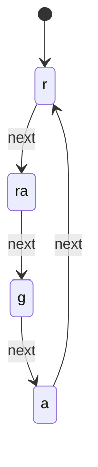

# One-Way Traffic Lights Without Control

This statechart models a single traffic signal operating continuously using only **":next"** events.

### Requirements Covered

- **R4**: The signal follows the UK traffic-light sequence **":r → :ra → :g → :a → :r"**.
- **R6**: Signal colours change only when a **":next"** event occurs.
- **R7**: The signal starts in the red **(:r)** state.
- **R3**: The cycle repeats using the minimum number of transitions required to reach green again.
- **R8**: The signal eventually reaches green during every cycle.

---

