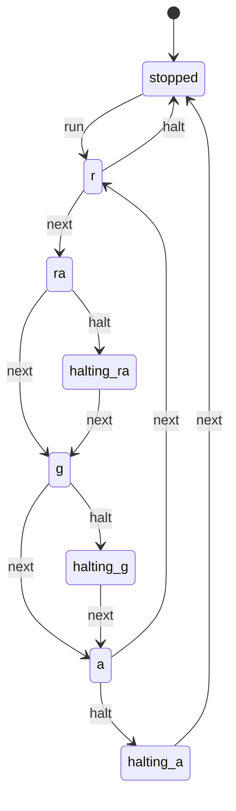

# One-Way Traffic Lights

This statechart shows a single traffic signal with operational control.

---
### Requirements Covered

- **R4**: The signal follows the UK traffic-light sequence **":r >> :ra >> :g >> :a >> :r"**.
- **R6**: Signal colours change only in response to **":next"**.
- **R7**: The system starts in the **"Stopped"** (all-red) state.
- **R9**: A **":run"** event transitions the system from the all-red state into normal operation.
- **R10**: A **":halt"** event causes the system to safely return to the all-red state.

---
