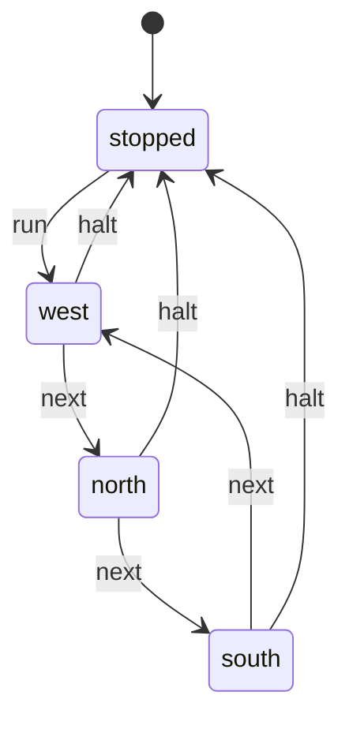

# Three-Way Traffic Lights

This statechart shows the 3-coordinated traffic signals (west, north, and south) that operates fairly, and prevents conflicting green light, and safely transition between running and stopped states.

---

### Requirements Covered
- **R4**: The signal follows the UK traffic-light sequence **":r >> :ra >> :g >> :a >> :r"**.
- **R5**: No two signals can display green or amber at the same time.
- **R7**: The system starts in the all-red state.
- **R8**: West, north, and south signals each eventually receive a green phase in a fair rotation.
- **R9**: A **":run"** event starts the traffic-light cycle.
- **R10**: A **":halt"** event causes the system to return safely to the all-red state.

---

